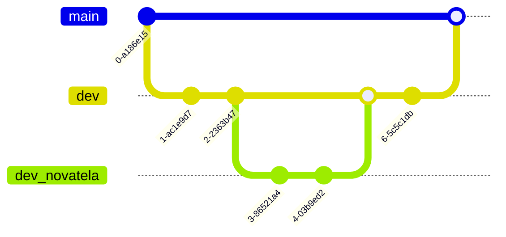
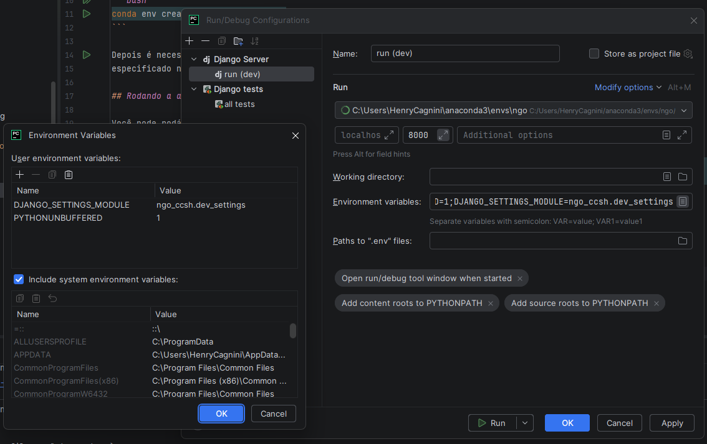

# Desenvolvimento

Esse documento explica como configurar o ambiente de desenvolvimento para a aplicação.

## Sumário

* [Onde fazer commits](#onde-fazer-commits)
* [Configuração](#configuração)
  * [Rodando a aplicação em ambiente de desenvolvimento](#rodando-a-aplicação-em-ambiente-de-desenvolvimento)
  * [Usando ferramentas de análise de qualidade de código (linters)](#usando-ferramentas-de-análise-de-qualidade-de-código-linters)
  * [Testando os modelos](#testando-os-modelos)
* [Variáveis de ambiente](#variáveis-de-ambiente)
* [Integração contínua](#integração-contínua)
* [Gerar diagramas do banco de dados](#gerar-diagramas-do-banco-de-dados)
* [Contrato da API](#contrato-da-api)

## Onde fazer commits

Existem duas branches principais: `main` e `dev`.

Na `main` deve ser mantido **apenas** o código de produção, pronto para ser usado. Já na `dev` deve ser mantido o código
de desenvolvimento, que contém código (a princípio) estável, mas que ainda não está totalmente testado.

Quando desenvolver um novo recurso, crie uma branch a partir da branch `dev`. Prefixe ela com `dev_*`, onde `*` deve ser
o nome do novo recurso sendo implementado. Commite para `dev` apenas quando tiver terminado de implementar o novo 
recurso:



## Configuração

Para desenvolvimento, recomenda-se utilizar o gerenciador de pacotes [conda](https://docs.conda.io/en/latest/), 
e criar um ambiente virtual para a aplicação:

```bash
conda env create -f environment.yml
```

Depois é necessário ativar o ambiente de trabalho com `conda activate ngo` (sendo `ngo` o nome do ambiente criado, 
especificado no arquivo `environment.yml`).

### Rodando a aplicação em ambiente de desenvolvimento

Crie o banco de dados com

```bash
conda activate ngo
python backend/manage.py create_dev_database --settings=ngo_ccsh.dev_settings
python backend/manage.py seed_dev_database --settings=ngo_ccsh.dev_settings
python backend/manage.py makemigrations --settings=ngo_ccsh.dev_settings
python backend/manage.py migrate --settings=ngo_ccsh.dev_settings
python backend/manage.py createsuperuser --settings=ngo_ccsh.dev_settings
```

> [!NOTE]
> É necessário usar um usuário que já exista no banco de dados para criar o super usuário. Use o CPF 00000000001
> para isto.

Rode a aplicação com 

```bash
python backend/manage.py runserver --settings=ngo_ccsh.dev_settings
```

Ou então criar uma configuração no PyCharm, adicionando a variável de ambiente `DJANGO_SETTINGS_MODULE` com o valor 
`ngo_ccsh.dev_settings`:



Teste a aplicação entrando na URL [http://localhost:8000/admin/](http://localhost:8000/admin/) e usando o usuário criado com o comando 
`createsuperuser`.

### Usando ferramentas de análise de qualidade de código (linters)

Execute estes comandos antes de dar commit, pois são os mesmos do workflow [lint.yml](.github/workflows/lint.yml):

```bash
black --check .  # garante estilo do código consistente
ruff check .  # verifica erros de programação 
pylint --recursive=y --errors-only --django-settings-module=ngo_ccsh.test_settings .  # verifica erros de programação
```

Caso encontre erros, você pode corrigir a maioria deles usando os mesmos pacotes:

```bash
black .
ruff check . --fix
```

### Testando os modelos

Você pode testar o funcionamento e consistência dos modelos da aplicação com os seguintes comandos:

```bash
python backend/manage.py validar_exercicio_financeiro --settings=ngo_ccsh.dev_settings
python backend/manage.py validar_pagamento_bolsas --settings=ngo_ccsh.dev_settings
```

## Variáveis de ambiente

Crie uma cópia do arquivo [.env.example](.env.example) com o nome `.env`, e preencha os campos de maneira apropriada.

O `EMAIL_HOST_PASSWORD` deve ser obtido a partir do [painel de controle de segurança do Google](https://myaccount.google.com/u/0/apppasswords), criando uma 
**senha de App** para o email.

## Integração contínua

O repositório usa dois workflows do GitHub Actions, em `.github/workflows/`:

* **lint.yml**: roda em todo pull request para a `main` e em cada push na `main`. Verifica formatação (`black --check`),
  estilo (`ruff`) e qualidade de código (`pylint`). Se alguma checagem falhar, o PR fica bloqueado até ser corrigido.
* **ci_cd.yml**: roda a cada push na `main`. Primeiro constrói a imagem Docker e roda os testes 
  (`python manage.py test`) com `ngo_ccsh.test_settings`; se os testes passarem, faz o deploy no servidor.

## Gerar diagramas do banco de dados

Para gerar diagramas do banco de dados, use o seguinte comando:

```bash
python .\backend\manage.py graph_models -a -g -o instance/models.png --settings=ngo_ccsh.dev_settings
```

## Contrato da API

Você pode verificar o contrato da API ao executar o backend e acessar o endereço `http://localhost:8000`:

```bash
python backend\manage.py runserver --settings=ngo_ccsh.dev_settings
```
