# Fluxo de validação de despesas

Este diagrama resume, em alto nível, quais entidades participam do cenário de
`test_models` e como os saldos mudam ao longo do exercício. Os valores representam
uma única natureza de recurso. O cenário termina com o exercício fechado e todos
os dados de teste revertidos.

```mermaid
flowchart TB

    subgraph transacao ["transações"]
        abre["abre o caixa do centro para um exercício fiscal"]
        injeta["injeta 1000 reais no orçamento do centro"]
        empenha["empenha 700 reais"]
        distribui["distribui 500 reais para uma unidade"]
        gasta["unidade gasta 200 reais"]

        abre --> injeta
        injeta --> empenha
        empenha --> distribui
        distribui --> gasta
    end

    subgraph saldos ["saldos"]
        saldo_centro_1["Saldo do Centro: R$ 0"]
        saldo_unidade_1["Saldo da Unidade: R$ 0"]
        saldo_empenho_1["Saldo do Empenho: R$ 0"]

        saldo_centro_2["Saldo do Centro: R$ 1000"]
        saldo_unidade_2["Saldo da Unidade: R$ 0"]
        saldo_empenho_2["Saldo do Empenho: R$ 0"]

        saldo_centro_3["Saldo do Centro: R$ 1000"]
        saldo_unidade_3["Saldo da Unidade: R$ 0"]
        saldo_empenho_3["Saldo do Empenho: R$ 700"]

        saldo_centro_4["Saldo do Centro: R$ 1000"]
        saldo_unidade_4["Saldo da Unidade: R$ 500"]
        saldo_empenho_4["Saldo do Empenho: R$ 700"]

        saldo_centro_5["Saldo do Centro: R$ 800"]
        saldo_unidade_5["Saldo da Unidade: R$ 300"]
        saldo_empenho_5["Saldo do Empenho: R$ 500"]

        saldo_centro_1 --> saldo_centro_2
        saldo_unidade_1 --> saldo_unidade_2
        saldo_empenho_1 --> saldo_empenho_2

        saldo_centro_2 --> saldo_centro_3
        saldo_unidade_2 --> saldo_unidade_3
        saldo_empenho_2 --> saldo_empenho_3

        saldo_centro_3 --> saldo_centro_4
        saldo_unidade_3 --> saldo_unidade_4
        saldo_empenho_3 --> saldo_empenho_4

        saldo_centro_4 --> saldo_centro_5
        saldo_unidade_4 --> saldo_unidade_5
        saldo_empenho_4 --> saldo_empenho_5
    end
```

O total do centro, o saldo do empenho e o saldo da unidade são dimensões diferentes
do mesmo razão. Por isso, no fechamento, R$ 300 são devolvidos debitando empenho e
unidade juntos; depois são devolvidos separadamente os R$ 200 restantes do empenho
e os R$ 300 que não foram empenhados.
