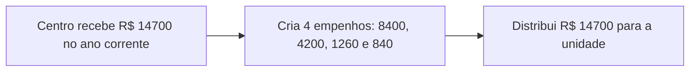
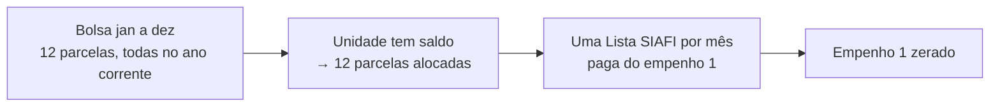
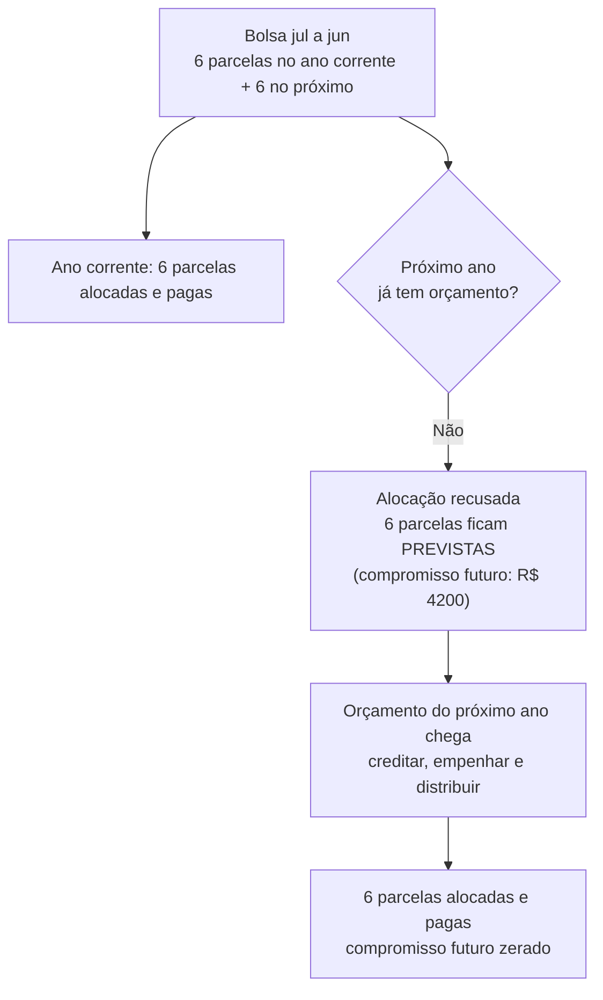
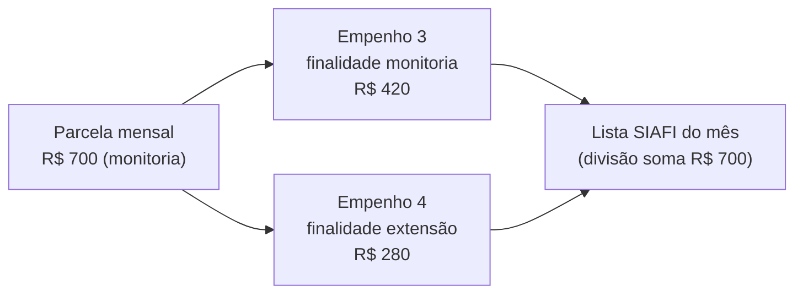

# Fluxo de validação do pagamento de bolsas

Resumo do cenário de `validar_pagamento_bolsas`. Toda bolsa tem parcelas mensais de
R$ 700. Uma parcela passa por três estados: **prevista** → **alocada** (reservada no
saldo da unidade) → **paga** (Lista SIAFI). Os dados de teste são revertidos ao final.

## Preparo

## Caso 1: bolsa de 12 meses, um único ano fiscal

## Caso 2: bolsa de 12 meses, atravessa dois anos fiscais

## Caso 3: parcela paga com dois empenhos

Os empenhos têm finalidades diferentes, mas a mesma natureza.

Se a divisão não somar o valor da parcela, o pagamento é recusado.

## Resultado esperado

| Caso | Resultado |
|------|-----------|
| 1 | 12 parcelas pagas; empenho 1 zerado |
| 2 | Sem orçamento no próximo ano, 6 parcelas ficam previstas; depois do orçamento são pagas |
| 3 | 3 parcelas pagas, cada uma 420 + 280; empenhos 3 e 4 zerados |
| Final | Saldo da unidade e do centro zerados no ano corrente |
